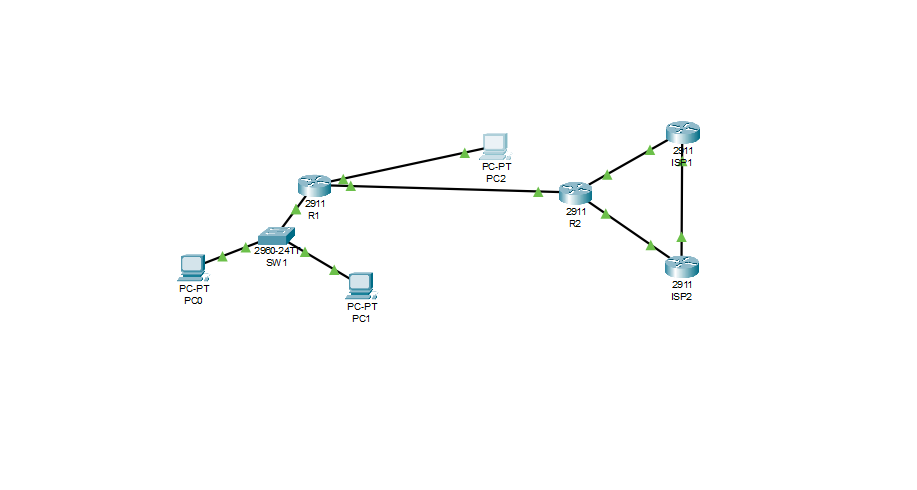
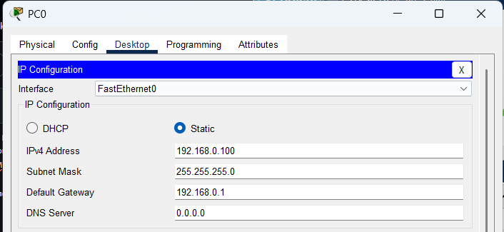
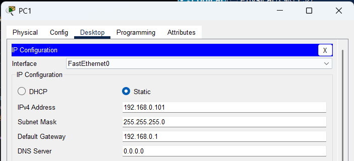
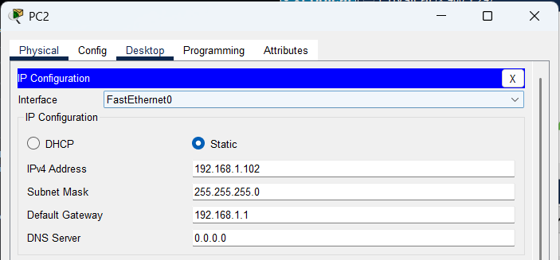
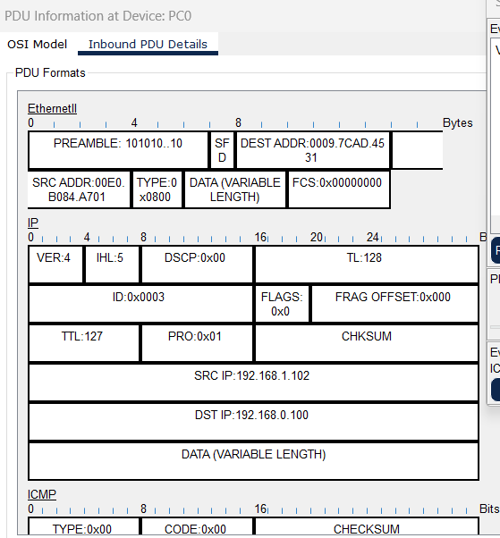
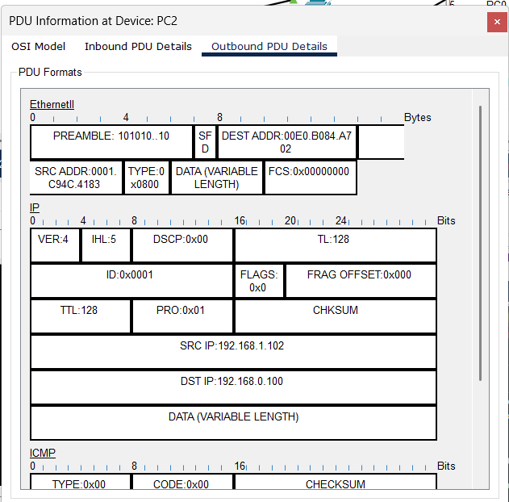

# Отчет по лабораторной работе 1.1
**Тема:** Базовая настройка, ARP, статическая маршрутизация  
**Выполнил:** Мазов С. М., гр. 409  

## Часть 1: Создание топологии и начальная конфигурация устройств

### Шаг 1

Собрали схему в Packet Tracer и соединили устройства по таблице портов.



Настроили статические IP-адреса, маски и шлюзы на компьютерах `PC0`, `PC1` и `PC2`.

  
  
  

Через консоль выполнили базовую настройку `R1`, `R2` и `SW1` (задали hostname, пароли, шифрование, параметры консоли и IP на интерфейсах), после чего сохранили конфиг.

```
hostname
no ip domain-lookup
service password-encryption
username admin privilege 15 secret 15
line console 0
logging synchronous
login local
speed 115200
int vlan 1
ip address 192.168.0.254 255.255.255.0
description MGMT
no shutdown
ip default-gateway 192.168.0.1
copy running-config startup-config
```

### Шаг 2

Проверили доступность узлов командой `ping` с `PC0` до `PC1` и `PC2`. Посмотрели таблицы MAC на `SW1` и ARP на `PC0` и `R1`.

```
ping
show mac address-table
show arp
arp -a

```

**Ответы на вопросы:**
1. Эхо-запросы проходят успешно
2. Вот так выглядит таблица коммутации на SW1 после проверки
              Mac Address Table
-------------------------------------------

Vlan    Mac Address       Type        Ports
----    -----------       --------    -----

   1    0007.ec5c.8e2d    DYNAMIC     Fa0/11
   1    0009.7cad.4531    DYNAMIC     Fa0/10
   1    00e0.b084.a701    DYNAMIC     Gig0/1]
3. Таблица ARP на R1
Protocol  Address          Age (min)  Hardware Addr   Type   Interface
Internet  10.10.12.2              -   00E0.B084.A703  ARPA   GigabitEthernet0/2
Internet  192.168.0.1             -   00E0.B084.A701  ARPA   GigabitEthernet0/0
Internet  192.168.0.100           216 0009.7CAD.4531  ARPA   GigabitEthernet0/0
Internet  192.168.0.101           216 0007.EC5C.8E2D  ARPA   GigabitEthernet0/0
Internet  192.168.1.1             -   00E0.B084.A702  ARPA   GigabitEthernet0/1
Internet  192.168.1.102           216 0001.C94C.4183  ARPA  

Таблица ARP на PC0
  Internet Address      Physical Address      Type
  192.168.0.1           00e0.b084.a701        dynamic
  192.168.0.101         0007.ec5c.8e2d        dynamic
  
## Часть 2: Роль IP и MAC адреса при прямой и косвенной пересылке

### Шаг 1

Перешли в режим симуляции, настроили фильтр на протокол `ICMP` и отправили пинг с `PC0` на `PC2`.

### Шаг 2

Открыли пакет на `PC0` и изучили заголовки.



* **Указан DEST MAC роутера** потому что PC2 находится в другой подсети, и PC- не может отправить ему кадр напрямую. Для выхода за пределы своей локальной сети компьютер использует шлюз, поэтому в Ethernet-заголовке всегда ставится MAC-адрес ближайшего маршрутизатора.

Прогнали симуляцию до `R1` и посмотрели `Outbound PDU Details`.



* **SRC и DEST MAC:** SRC ADDR:0001.C94C.4183, DEST ADDR:00E0.B084.A702.
Изменились они потому что это обратный путь. Когда PC2 отправляет ответ обратно на PC0, и кадр движется от PC2 к R1. Поскольку PC0 находится в другой подсети, PC2 не может отправить ему данные напрямую и указывает в поле SRC MAC свой собственный адрес, а в DEST MAC — адрес интерфейса роутера. Сами MAC-адреса меняются на каждом участке сети потому, что Ethernet-кадр действует только в пределах одной локальной сети: роутер всегда стирает старый заголовок второго уровня и заново упаковывает пакет с новыми MAC-адресами для следующего сегмента сети, оставляя неизменными только конечные IP-адреса.

## Часть 3: Протокол ARP

### Шаг 1

1. Вышли из режима симуляции.
2. Очистили ARP таблицу на PC0.
3. Запустили режим симуляции.
4. В фильтрах выберали протокол ARP.
5. Отправили эхо-запросы с PC0 на R1.

### Шаг 2

Изучили сообщение протокола ARP, созданное на PC0


1. TYPE: 0x0806
2. DEST: 0009.7CAD.4531. Устройство - R1. SW1 сверит MAC-адрес назначения со своей таблицей коммутации и перешлет кадр напрямую в тот единственный порт, к которому подключен PC0.
3. OPCODE: 0x0002
4. SOURCE MAC и SOURCE IP устройства PC0
5. TARGET MAC: 0009.7CAD.4531

Пролистали Events до момента, когда сообщение достигло R1.

1. DEST: 0009.7CAD.4531. Устройство - R1. SW1 сверит MAC-адрес назначения со своей таблицей коммутации и перешлет кадр напрямую в тот единственный порт, к которому подключен PC0.
2.  OPCODE: 0x0002
3.  SOURCE принадлежит R1. TARGET - PC0.
